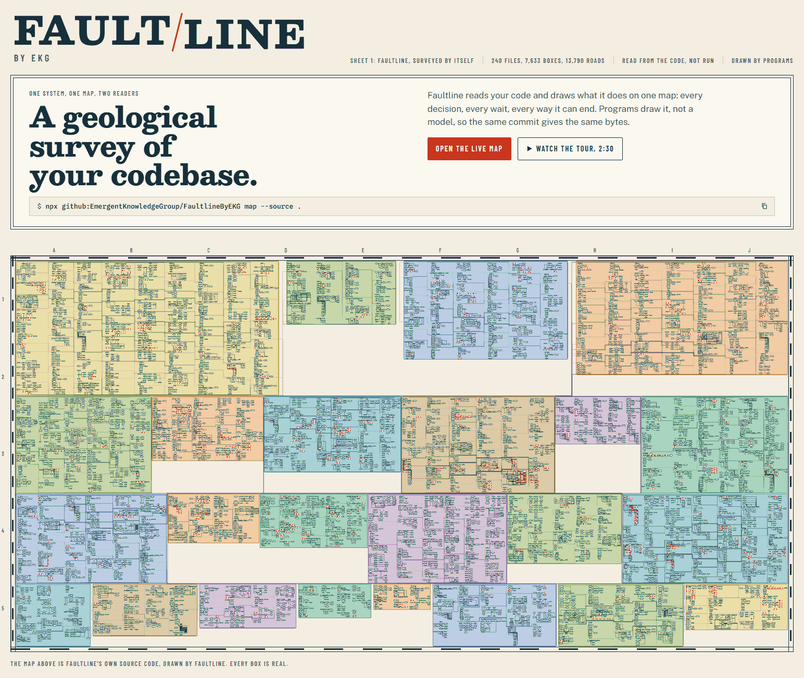
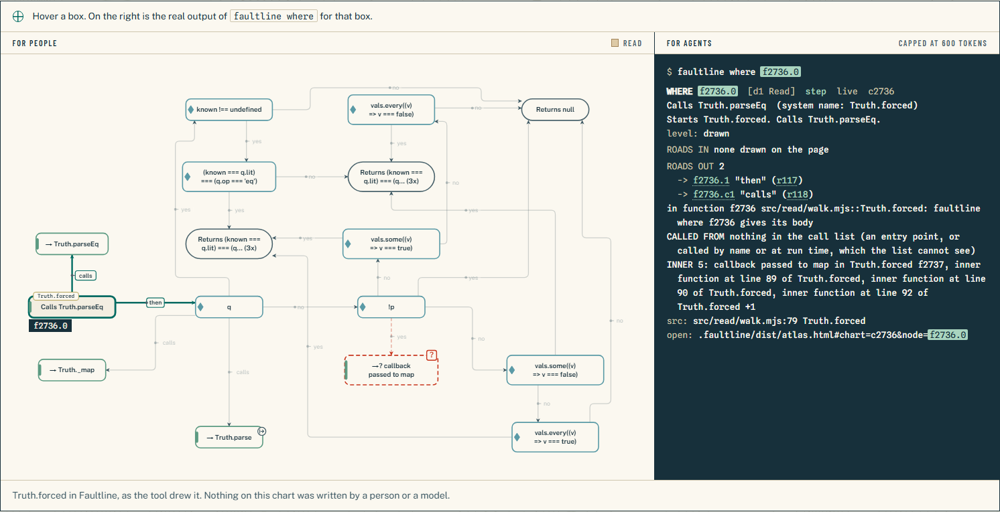

<p align="center">
  <a href="https://emergentknowledgegroup.github.io/FaultlineByEKG/">
    <picture>
      <source media="(prefers-color-scheme: dark)" srcset=".github/assets/wordmark-dark.svg">
      
    </picture>
  </a>
</p>

<h3 align="center">A geological survey of your codebase.</h3>

<p align="center">
  <a href="https://emergentknowledgegroup.github.io/FaultlineByEKG/"><strong>Site and tour</strong></a> &nbsp;·&nbsp;
  <a href="https://emergentknowledgegroup.github.io/FaultlineByEKG/demo/self/">Live map of Faultline itself</a> &nbsp;·&nbsp;
  <a href="https://emergentknowledgegroup.github.io/FaultlineByEKG/bullmq.html">A large codebase: BullMQ</a> &nbsp;·&nbsp;
  <a href="#run-it">Run it</a> &nbsp;·&nbsp;
  <a href="#what-this-map-cant-tell-you">Limits</a>
</p>

<picture>
  <source media="(prefers-color-scheme: dark)" srcset=".github/assets/hero-dark.png">
  
</picture>

<p align="center"><sub>Faultline's own source code, drawn by Faultline.</sub></p>

Faultline reads your code and draws what it does on one map: every decision, every wait, every way it can end. Programs draw it, not a model, so the same code gives the same bytes.

People get one HTML file to zoom, hover and walk. Agents get the same map as short text, with a token cap on every answer. Same box, same id, so you can hand your agent the exact spot you mean.

## Run it

```
npx github:EmergentKnowledgeGroup/FaultlineByEKG map --source .
```

Then open `.faultline/dist/atlas.html`. One file. No server, no network. Your code is only read, never run. Needs Node 24 or newer.

If the code has Python, run `npx github:EmergentKnowledgeGroup/FaultlineByEKG setup` once first. It fetches a pinned type checker and checks its hash. TypeScript, JavaScript and Lua come with the install.

Prefer a clone:

```
git clone https://github.com/EmergentKnowledgeGroup/FaultlineByEKG
cd FaultlineByEKG && npm install
node bin/faultline.mjs map --source /path/to/your/code
```

## Solid where the code proves it. Dashed where it doesn't.

Geologists have drawn faults this way for over a century: a solid line where the fault is accurately located, a dashed line where it is inferred, a question mark where its existence is in doubt. A map that hides the difference is worse than no map.

Faultline draws the same way. A box or road is solid when a type checker or the flow graph decided it. It is dashed with a `?` when the tool only matched a name, or can't see the caller. Open it and the panel says why.

<picture>
  <source media="(prefers-color-scheme: dark)" srcset=".github/assets/readers-dark.png">
  
</picture>

## One map, two readers

| Command | Answers | Cap, tokens |
|---|---|---|
| `faultline brief` | what the code is, what was read and what's open | 1200 |
| `faultline where <box, function, name or file:line>` | which box, its roads in and out | 600 |
| `faultline breaks` | the ranked questions | 800 |
| `faultline path <a> <b>` | a route the roads allow, with its conditions | 400 |
| `faultline impact <box or file>` | what's downstream, which endings are reachable | 500 |
| `faultline status` | what was read, whether the page matches the stored map (not the code) | 200 |

The same six are served over MCP with `faultline mcp`. The rules for an agent are in [`skills/faultline/SKILL.md`](skills/faultline/SKILL.md).

## When this fails, who hears about it?

Most of what goes wrong in production doesn't crash. It fails quietly, somewhere nobody is looking. So at every failure and refusal in the code, Faultline asks who finds out: a person, the calling code, a log, or nobody. When the code doesn't say, the page says "not known from the code" and leaves it open.

A candidate is a question, not a bug. Nothing here was run, and many will turn out to be fine.

## Programs draw. The agent never does.

An agent that draws your map can invent a road that isn't there, and you would never know. So the map is made with no model at all: no key, no network, nothing to write by hand.

An agent helps in two places only. `faultline review` lets it answer the questions the tool flagged, citing a line the tool re-reads. `faultline story` lets it write what the code is for, on top, with every word marked as words. It can't add a box or a road: `story apply` refuses them.

## The story, and the receipts

The [live map of Faultline itself](https://emergentknowledgegroup.github.io/FaultlineByEKG/demo/self/) is the tool map of this repo. For a larger test, the demo shows BullMQ, an open source job queue, both ways: the [tool map](https://emergentknowledgegroup.github.io/FaultlineByEKG/demo/tool/), made by programs alone, and the [story map](https://emergentknowledgegroup.github.io/FaultlineByEKG/demo/story/), where an agent wrote the words. The story reads better. The tool map is the receipts.

## What we measured, including what didn't work

Measured on the last full round of tests, just before the final fixes, and not re-run since. One reader or one run each, so treat these as signs, not statistics.

| | Result | What it doesn't show |
|---|---|---|
| **Same bytes** | Two runs on Faultline's own code: 2,690 files, every one byte-identical apart from timing logs. The same on BullMQ | Holds for the same tool versions and Python environment, on one Windows PC. It shows the drawing repeats, not that it's right |
| **Attacker** | 129 boxes and roads read against the source on three systems: 0 false, upper bound 2.3% | Scripts did find six false roads on one large system, through a finally block inside a loop. Some words on top of the map were wrong too. Treat switch defaults and error-handler wording as leads |
| **Blind readers** | 12 tasks, page only: tool map 18 of 24, story map 22 of 24 | One reader per page |
| **Exam** | 75 facts, map's text commands only: tool map 32, story map 61 | The map alone gets about half as far. Commands were improved after this and not re-tested |
| **Agents with and without the map** | Orientation on a large system: about half the tokens (57k vs 115k). Pointed questions: no real difference. Known defects by symptom: no faster | One run per question. The map doesn't find bugs. Asking who hears does |
| **Who hears** | Put to three real systems. A separate checker: 97 verdicts, 65 held, 26 partly, 4 wrong, 2 unclear | On hand-written maps. Read, not run, apart from two tiny scripts |
| **Story check** | 36 of 123 planted fakes still read clean | It proves two lines are joined, nothing about what the words claim |

## What this map can't tell you

- **It reads code. It doesn't run it.** A candidate is a shape worth a question.
- **It can't read intent.** It doesn't know what matters, what success means, or why a retry exists. That is what the story layer is for.
- **It is the code as of the last `map` run.** `status` checks the page against the stored map, not against the code. Run `map` again after the code changes.
- **Callbacks, decorators and dynamic names** are flagged, not guessed.
- **Stages are groups of folders,** not steps. The tool claims no running order.
- **Very large code** doesn't get a chart for every function. The page stays under about 16 MB, and the rest are outlines. The tool map has no whole-system chart in the page yet; the story map does.
- **Reads Python, TypeScript, JavaScript and Lua.** Tested only on Windows 10 with Node 24 and Python 3.13. Treat anything else as unknown, and tell us. Pull requests for other languages and platforms are welcome.

## Limits and safety

- **What it reads.** The source folder you point `--source` at, as text. It never runs it. It writes only into the `.faultline` folder, or the folder you give with `--project`. Everything runs offline after install, except `setup`, which downloads one file and checks its hash.
- **It stays inside that folder.** A link that leads outside the source folder is skipped, and a path in a map, answers or story file that leaves it is refused.
- **TypeScript follows its config out of the folder.** The TypeScript checker follows imports and a `tsconfig.json`'s `extends`, `paths` and `typeRoots` the way `tsc` does, so it may open files those name outside the source folder. Only each file's name and the names it declares reach the map (as `excluded:<file>` in `map/calls.json`), never its text. It is not blocked because that would break monorepos whose `tsconfig` extends a parent file.
- **A `.faultline` folder from someone else is untrusted input.** A repo you clone can ship one. Delete it and run `faultline map` yourself, or map into a new `--project` folder, before you trust it, review it or build on it.
- **The freshness check is a drift check.** `review` and `story check` refuse when a file the map read has changed. They do not notice a file added since, and the check value sits in the map folder, so it is no seal on a folder someone else made.
- **Found a problem?** Open an issue on [GitHub](https://github.com/EmergentKnowledgeGroup/FaultlineByEKG/issues). More in [`SECURITY.md`](SECURITY.md).

## What it isn't

It isn't a linter: it doesn't tell you what to change. It isn't a call graph: roads carry conditions, and endings have outcomes. If you want a queryable symbol graph across many languages, [CodeGraphContext](https://github.com/CodeGraphContext/CodeGraphContext) does that well. It isn't a model checker: a checker proves what breaks inside a small model, and this shows where that break sits in the whole system, what leads there, and what nobody has checked. They work well together.

## More

[Guide](docs/GUIDE.md): every command, the review and story layers, files, languages, writing a map by hand. [Contracts](docs/CONTRACTS.md): what each command reads and writes. [Contributing](CONTRIBUTING.md). [Security](SECURITY.md).

BullMQ is an independent open source project under the MIT licence, used here as a test subject. It has no connection to Faultline.

MIT. Faultline by EKG, Emergent Knowledge Group. Third-party software and its licences are in [`THIRD_PARTY.md`](THIRD_PARTY.md).
